

<!-- ANIMATED TYPING HEADLINE -->

 

<!-- ANIMATED HERO BADGE -->
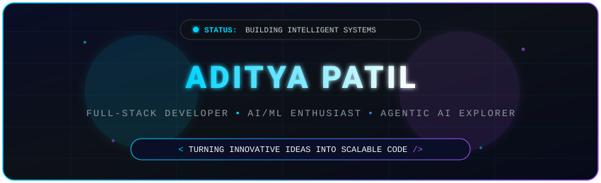

  

<!-- ANIMATED TERMINAL -->
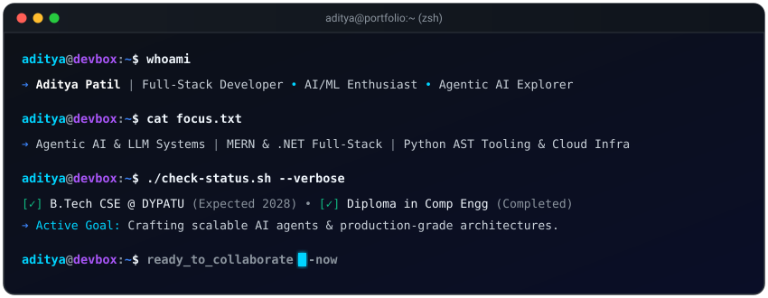

  

<!-- SCROLLING TECH MARQUEE -->

 

<!-- ANIMATED SOCIAL BUTTONS -->

  
  &nbsp;&nbsp;
  

 

<!-- SECTION: ABOUT ME -->

_ About Me" />


Hi, I'm **Aditya Patil**. I build intelligent applications at the intersection of AI, automation, and full-stack development, with a focus on solving real-world problems through technology. I'm particularly interested in Agentic AI, Generative AI, AI/ML, automation, MERN Stack, .NET development, and AI-powered applications. I enjoy exploring emerging technologies, building practical projects, and turning innovative ideas into scalable solutions.

 

<!-- SECTION: EDUCATION -->

_ Education & Milestones" />


 

<!-- SECTION: CURRENT FOCUS -->

_ Current Focus" />


 

<!-- SECTION: TECH STACK -->

_ Technical Proficiency" />

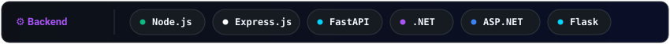

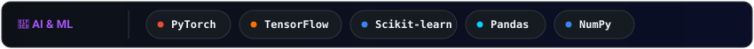

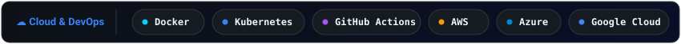

 

  

 

<!-- SECTION: FEATURED PROJECTS -->

_ Featured Projects" />

<a href="https://github.com/adityapatil400?tab=repositories">
  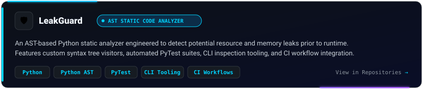
</a>

  

<a href="https://github.com/adityapatil400?tab=repositories">
  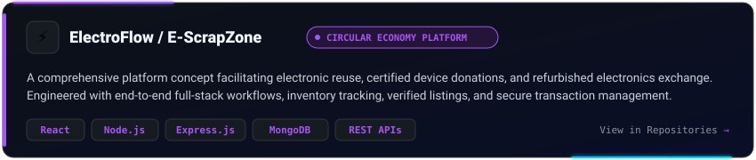
</a>

> *Note: Active project repositories, source code, and ongoing builds are accessible directly on my [GitHub Repositories](https://github.com/adityapatil400?tab=repositories) page.*

 

<!-- SECTION: GITHUB ANALYTICS -->

_ GitHub Activity & Stats" />

<!-- CONTRIBUTION SNAKE -->
<picture>
  <source media="(prefers-color-scheme: dark)" srcset="https://raw.githubusercontent.com/adityapatil400/adityapatil400/output/github-contribution-grid-snake-dark.svg">
  <source media="(prefers-color-scheme: light)" srcset="https://raw.githubusercontent.com/adityapatil400/adityapatil400/output/github-contribution-grid-snake.svg">
  
</picture>
  

<!-- ANIMATED REAL-TIME STATS CARD -->

 

<!-- SECTION: CONNECT -->

_ Connect & Collaborate" />

  I am always open to exploring technical internship opportunities, collaborating on open-source AI tools, and building scalable full-stack applications. Feel free to connect!

  
  &nbsp;&nbsp;&nbsp;&nbsp;
  

 

<!-- FOOTER -->

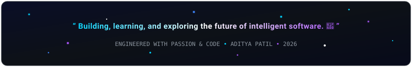

 

<!-- ANIMATED WAVE FOOTER -->

  Designed &amp; engineered with precision for <b>Aditya Patil</b> • All animations live-rendered in code

